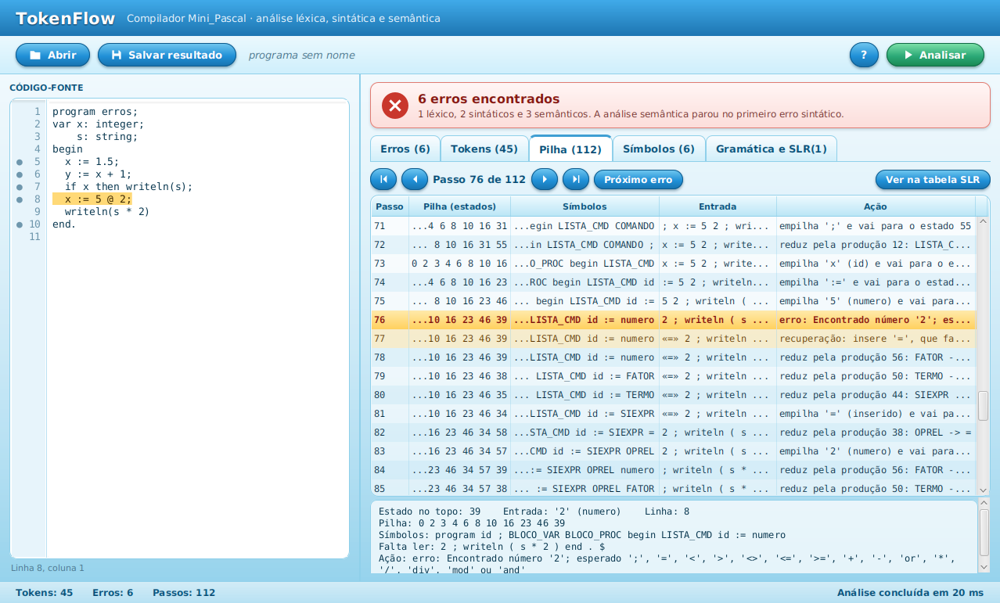
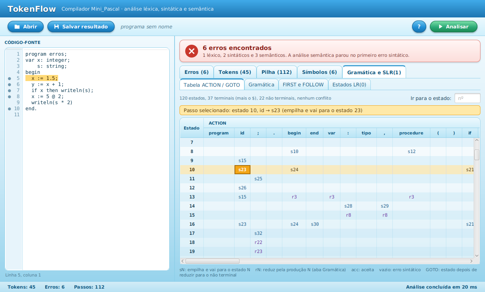
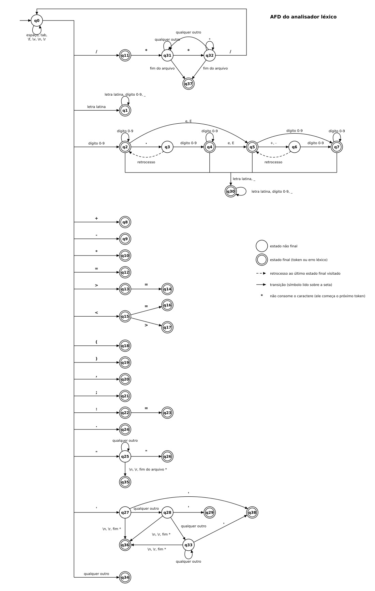

<div align="center">

# 🌀 TokenFlow

### Compilador para Mini_Pascal: análise léxica, sintática e semântica

*Trabalho de Compiladores - Unidades I e II - UESB*


</div>

---

## Sobre o projeto

O **TokenFlow** é um compilador, em construção, para o **Mini_Pascal**, uma linguagem
simplificada inspirada em Pascal.

- **Análise léxica (Unidade I, concluída):** um **Autômato Finito Determinístico** construído
  manualmente (sem geradores de lexer prontos) lê o código-fonte e devolve, para cada palavra
  reconhecida, o par **lexema → token**, com as classes léxicas exigidas no enunciado. Erros
  léxicos são **reportados e recuperados**: um caractere inválido ou uma string mal fechada
  nunca travam a análise nem derrubam o resto do arquivo. A versão entregue na Unidade I está
  na tag `unidade-1`.
- **Análise sintática e semântica (Unidade II, em desenvolvimento):** analisador **SLR(1)**
  com gerador de tabelas próprio, a partir da gramática do enunciado, e análise semântica
  feita nas reduções, com **tabela de símbolos** de escopos aninhados e verificação de
  **tipos**. Recebe um programa e devolve `OK` ou o conjunto das mensagens de erro, cada uma
  com o tipo (léxico, sintático ou semântico) e a linha: a análise se recupera de cada erro
  sintático e segue até o fim do arquivo.
- **Interface gráfica:** mostra o resultado das três fases e o funcionamento do analisador:
  os tokens, a pilha do SLR(1) passo a passo, a tabela de símbolos, a gramática, FIRST e
  FOLLOW, os estados LR(0) e a tabela ACTION/GOTO, com a célula usada em cada passo
  destacada.

## Como é

À esquerda fica o código, sempre visível, com números de linha e uma marca `●` nas linhas
com erro. À direita, uma faixa diz se o programa está correto ou quantos erros há, e as abas
seguem a ordem das fases do compilador:

| Aba | O que mostra |
|---|---|
| **Erros** | Erros léxicos, sintáticos e semânticos em ordem de linha, com a fase e a mensagem |
| **Tokens** | A análise léxica: lexema e classe de cada token (a saída da Unidade I) |
| **Pilha** | A análise SLR(1) passo a passo: pilha de estados, símbolos, entrada que falta ler e ação (empilha, reduz, aceita). Erros e recuperações aparecem como passos, e há botões para andar pelos passos e pular para o próximo erro |
| **Símbolos** | A tabela de símbolos montada pela análise semântica: escopo, nível, nome, categoria, tipo, linha e parâmetros |
| **Gramática e SLR(1)** | A tabela ACTION/GOTO, a gramática numerada, FIRST e FOLLOW e os estados LR(0) com itens e transições |

Clicar num erro, token, passo ou símbolo seleciona a linha correspondente no código. Com um
passo selecionado, **Ver na tabela SLR** abre a tabela ACTION/GOTO na célula que o analisador
usou naquele passo. Atalhos: `Ctrl+O` abre um arquivo, `Ctrl+Shift+S` salva o código do editor,
`F5` ou `Ctrl+Enter` analisa e `Ctrl+S` salva o resultado; o botão `?` resume tudo isso.





## Autômato

O analisador léxico implementa o AFD abaixo (39 estados: 30 finais e 9 não finais). A figura é
gerada por `docs/gerar_automato.py`, a partir do mesmo autômato que a suíte `VerificacaoAfd`
compara com o analisador.



## Funcionalidades

**Análise léxica**

- ✅ Reconhece todas as classes léxicas do enunciado: palavra reservada, identificador,
  número inteiro/real (com notação científica), operadores aritméticos/relacionais/lógicos,
  símbolo especial, atribuição, fim, constante string e char
- ✅ Tabela com as **48 palavras reservadas** do enunciado (`DOWTO` lido como `downto`) +
  `procedure` (incluída na Unidade II) + `mod`/`and`/`or`/`not`, busca O(1),
  **case-insensitive** (`Program`, `PROGRAM` e `program` são todos reconhecidos)
- ✅ Comentários de bloco `/* */`, inclusive multilinha, com recuperação de erro se não
  fecharem
- ✅ Strings e chars mal formados geram erro léxico **sem travar o resto do arquivo**
- ✅ Limite de 63 caracteres em identificadores (truncamento, não erro)

**Análise sintática**

- ✅ Gramática do enunciado em arquivo de texto (`gramatica.txt`), convertida para GLC, sem
  conflitos SLR(1): 65 produções, 132 estados
- ✅ Gerador próprio de tabelas SLR(1): FIRST, FOLLOW, coleção canônica LR(0), tabelas
  ACTION/GOTO, recusa de qualquer conflito, relatório completo e tabela em CSV
- ✅ Analisador empilha/reduz com pilha de estados e pilha de atributos, onde a análise
  semântica se encaixa
- ✅ Saída `OK` ou erros com tipo e linha, dizendo o que foi encontrado e o que era esperado
- ✅ Recuperação de erros: uma análise relata todos os erros do programa, sem erros em
  cascata (modo pânico do livro do Dragão mais inserção do símbolo que falta, escolhendo a
  retomada que vai mais longe)
- ✅ Linha de comando para cada etapa da análise e para o gerador de tabelas

**Análise semântica**

- ✅ Ações semânticas executadas nas reduções do SLR(1), numa única passada pelo texto
- ✅ Tabela de símbolos com escopos aninhados (global, procedimentos e procedimentos dentro
  de procedimentos), com `read`, `write` e `writeln` predefinidos
- ✅ Nomes: não declarado, declarado duas vezes, procedimento usado como variável e o contrário
- ✅ Tipos: atribuição, operadores (`div`/`mod` só com integer, `/` sempre real, `and`/`or`/`not`
  só com comparações), comparações e condições de `if`/`while`
- ✅ Chamadas: número de argumentos, tipo de cada um e parâmetro `var` recebendo variável do
  mesmo tipo
- ✅ Sem cascatas: uma expressão com erro não gera mais mensagens

**Interface gráfica**

- ✅ Carregar um `.txt` **ou** digitar/colar código direto na tela, com números de linha
- ✅ Resultado da análise completa (`OK` ou os erros) e salvamento em arquivo UTF-8; se o
  código mudou depois da análise, ele é analisado de novo antes de salvar, e o resultado não
  pode ser gravado por cima do arquivo do programa
- ✅ Salvar o código do editor; abrir outro arquivo ou fechar a janela com alterações não
  salvas pergunta antes de descartá-las
- ✅ Mesmo resultado da linha de comando para qualquer arquivo: quebras de linha `\r\n` e `\r`
  viram `\n` ao carregar, `\f` e `\v` (separadores, como o espaço) viram espaço, e
  caracteres de controle (invisíveis) aparecem como `□`, a mesma marca das mensagens de erro
- ✅ Pilha do SLR(1) passo a passo, ligada ao código e à tabela ACTION/GOTO
- ✅ Tokens, tabela de símbolos, gramática, FIRST/FOLLOW e estados LR(0)
- ✅ Aviso quando o código muda depois da análise; atalhos de teclado e ajuda

**Testes**

- ✅ **716 verificações automatizadas** em 17 suítes, sem JUnit: casos absurdos e de robustez
  do léxico (número colado em identificador, comentário "aninhado", CRLF e CR solto, emoji,
  arquivo ANSI/UTF-16, locale turco...), tabelas SLR conferidas com o livro do Dragão,
  mensagens de erro exatas, programas gerados a partir da gramática, recuperação de erros
  (vários erros, cascata, textos aleatórios, desempenho), passos da pilha mostrados na
  interface (conferidos com a figura 4.38 do livro do Dragão), análise semântica (cada regra,
  escopos, programas gerados bem tipados e com um erro injetado de cada tipo), regras de
  arquitetura e os arquivos de teste da Unidade II
- ✅ 8 arquivos de teste de integração do léxico, incluindo os dois exemplos do enunciado
- ✅ 11 arquivos de teste da Unidade II (dois programas corretos, um para cada tipo de erro,
  um para o `for`, um com erros misturados e o programa da apresentação), cada um com o resultado esperado
  conferido à mão

## Arquitetura

O código é dividido em módulos com responsabilidade única. Cada módulo só usa os que estão
abaixo dele, e a suíte `VerificacaoArquitetura` confere essa regra a cada build:

```
src/minipascal/
├── lexico/        → análise léxica (não depende de nenhum outro módulo)
│   ├── model/        Token, TipoToken (o "vocabulário" da linguagem)
│   ├── tabela/       TabelaPalavrasReservadas (busca O(1) via HashMap)
│   ├── core/         AnalisadorLexico (o autômato), DescricaoErroLexico
│   └── verificacao/  suítes da Unidade I
├── erros/         → CategoriaErro, ErroCompilacao (tipo, linha e mensagem de um erro)
├── io/            → LeitorArquivoFonte, EscritorArquivoSaida (sempre UTF-8 na saída)
├── sintatico/     → análise sintática
│   ├── gramatica/    Gramatica, Producao, LeitorGramatica + gramatica.txt e expressoes.txt
│   ├── slr/          FIRST/FOLLOW, coleção LR(0), TabelaSLR, ExportadorTabela
│   ├── parser/       AnalisadorSintatico, AdaptadorLexico, Terminal, ResultadoAnalise,
│   │                 RastroAnalise e PassoAnalise (os passos da pilha, para a interface)
│   └── verificacao/  suítes da análise sintática
├── semantico/     → análise semântica: AnalisadorSemantico (as ações de redução),
│   │                TabelaSimbolos, Simbolo, Tipo, Compilador (as três fases juntas)
│   └── verificacao/  suítes da análise semântica
├── cli/           → linha de comando: AnaliseLexica, AnaliseSintatica, AnaliseSemantica,
│                    GeradorTabelas, Console, Caminhos
├── gui/           → interface JavaFX: MainApp, AnalisadorController, Main.fxml,
│                    EditorCodigo, PainelSLR, application.css, icon.png
└── verificacao/   → VerificacaoArquitetura (regras entre os módulos)
```

Ordem das camadas, de baixo para cima: `lexico` → `erros` → `io` → `sintatico` →
`semantico` → `cli` e `gui`. Os módulos de análise não sabem nada sobre
arquivos de saída, console ou janela; a linha de comando e a interface usam os mesmos
analisadores, sem duplicar lógica. Os recursos da interface ficam na mesma pasta da classe
que os carrega, `src/minipascal/gui/`.

## Como rodar

### Pré-requisito

**JDK 8** com JavaFX embutido (ex: Oracle JDK 8u202).

### Interface gráfica (sem compilar)

O `TokenFlow.jar` já vem no repositório. No Windows, dê duplo clique em `TokenFlow.bat`: ele
procura o JDK 8 em `C:\Program Files\Java` e abre o programa com ele, não importa qual
`java` esteja no `PATH`.

Pelo terminal, só funciona se o `java` do `PATH` for o JDK 8 (os Java 11+ não trazem o
JavaFX e dão `NoClassDefFoundError: javafx/application/Application`):

```bash
java -jar TokenFlow.jar
```

Se o `PATH` apontar para outro Java, chame o JDK 8 pelo caminho completo:

```powershell
& "C:\Program Files\Java\jdk1.8.0_202\bin\java.exe" -jar TokenFlow.jar
```

### Linha de comando

| Para quê | Comando |
|---|---|
| Análise léxica (listagem lexema/token, Unidade I) | `java -cp TokenFlow.jar minipascal.cli.AnaliseLexica entrada.txt [saida.txt]` |
| Análise sintática (`OK` ou os erros léxicos e sintáticos) | `java -cp TokenFlow.jar minipascal.cli.AnaliseSintatica programa.txt [saida.txt]` |
| **Análise completa: léxica, sintática e semântica** (`OK` ou os erros, Unidade II) | `java -cp TokenFlow.jar minipascal.cli.AnaliseSemantica [--tabela] programa.txt [saida.txt]` |
| Relatório e tabela SLR(1) de uma gramática | `java -cp TokenFlow.jar minipascal.cli.GeradorTabelas gramatica.txt [pasta-saida]` |

- **Análise léxica:** sem o segundo argumento, a saída é gravada ao lado da entrada como
  `<entrada>_saida.txt`, um par lexema/token por linha. Código de saída 0 quando a listagem é
  gravada (os erros léxicos fazem parte dela) e 1 quando não foi possível ler ou gravar.
- **Análise sintática:** o arquivo deve conter um programa completo, de `program` até o `.`
  final. Imprime `OK` ou todos os erros encontrados, um por linha, em ordem de linha, por
  exemplo `Erro sintático na linha 3: Encontrado '*'; esperado número, identificador, '(',
  constante string, constante char ou 'not'`. Com `[saida.txt]`, grava o mesmo resultado em UTF-8.
  Código de saída 0 quando o resultado é `OK` e 1 caso contrário.
- **Análise completa:** como a sintática, mas com a análise semântica junto; é a saída pedida
  pelo enunciado da Unidade II. Com `--tabela`, imprime também a tabela de símbolos (escopo,
  nível, nome, categoria, tipo, linha e parâmetros).
- **Gerador de tabelas:** aceita um arquivo de gramática ou o nome de uma gramática embutida
  (`gramatica.txt` ou `expressoes.txt`). Grava `<nome>_tabela_slr.txt` (gramática numerada,
  FIRST, FOLLOW, estados LR(0) com itens e transições, tabela e conflitos) e
  `<nome>_tabela_slr.csv`. Código de saída 1 se a gramática for inválida ou tiver conflitos.

Antes de analisar, os caminhos são conferidos: entrada que é uma pasta, saída igual à entrada
(mesmo escrita de outra forma, como `./programa.txt` ou `pasta/../programa.txt`), saída que é uma pasta ou pasta de saída que não existe dão uma mensagem dizendo isso (e código
de saída 1), sem analisar nem gravar nada.

No console os acentos são removidos, porque o console do Windows com Java 8 não os mostra;
os arquivos gravados ficam em UTF-8, com acentos.

### Compilar e gerar o jar de novo

Um comando só, na raiz do projeto:

| Sistema | Comando |
|---|---|
| Windows (PowerShell, CMD ou duplo clique) | `.\build.bat` |
| Linux, macOS ou Git Bash | `sh build.sh` |

O script compila tudo, copia para dentro do jar os recursos da interface (FXML, CSS e ícone)
e as gramáticas, e gera o `TokenFlow.jar`. No Windows ele procura sozinho o JDK 8 em
`C:\Program Files\Java\jdk1.8*`, então não importa qual `java` está primeiro no `PATH`. A
lista dos fontes vai para o compilador num arquivo (`out/fontes.txt`), então a pasta do
projeto pode ter qualquer nome, longo ou com espaços e acentos.

Para compilar **e** rodar todas as verificações automatizadas:

```bash
.\build.bat teste       # Windows
sh build.sh teste      # Linux, macOS, Git Bash
```

### Rodar a partir do código-fonte, sem o script

```bash
javac -encoding UTF-8 -d out $(find src -name "*.java")
cp src/minipascal/gui/*.fxml src/minipascal/gui/*.css src/minipascal/gui/*.png out/minipascal/gui/
cp src/minipascal/sintatico/gramatica/*.txt out/minipascal/sintatico/gramatica/
java -cp out minipascal.gui.MainApp
```
Em IDEs (IntelliJ, VS Code) basta abrir a pasta: `src` é a única raiz de código e os
recursos já estão nela.

## Como rodar os testes

Cada suíte é uma classe Java independente (sem JUnit), que imprime `[OK]`/`[FALHA]` linha a
linha e termina com um resumo. `.\build.bat teste` roda todas, a partir da raiz do projeto;
para rodar uma só:

```bash
java -cp TokenFlow.jar minipascal.lexico.verificacao.VerificacaoFase3     # model + tabela
java -cp TokenFlow.jar minipascal.lexico.verificacao.VerificacaoFase4     # núcleo do lexer
java -cp TokenFlow.jar minipascal.lexico.verificacao.VerificacaoFase5     # comentários e erros
java -cp TokenFlow.jar minipascal.lexico.verificacao.VerificacaoFase6     # leitura/escrita de arquivo
java -cp TokenFlow.jar minipascal.lexico.verificacao.VerificacaoAbsurda   # casos extremos/maldosos
java -cp TokenFlow.jar minipascal.lexico.verificacao.VerificacaoRobustez  # Unicode, codificações, linha de comando
java -cp TokenFlow.jar minipascal.lexico.verificacao.VerificacaoAfd       # AFD (tabela de transições) x analisador
java -cp TokenFlow.jar minipascal.sintatico.verificacao.VerificacaoAdaptador        # tokens -> terminais da gramática
java -cp TokenFlow.jar minipascal.sintatico.verificacao.VerificacaoGeradorSLR       # gerador de tabelas SLR(1)
java -cp TokenFlow.jar minipascal.sintatico.verificacao.VerificacaoParserExpressoes # parser com a gramática das expressões
java -cp TokenFlow.jar minipascal.sintatico.verificacao.VerificacaoParserCompleto   # parser com a gramática completa
java -cp TokenFlow.jar minipascal.sintatico.verificacao.VerificacaoRecuperacao      # recuperação de erros sintáticos
java -cp TokenFlow.jar minipascal.sintatico.verificacao.VerificacaoRastro           # passos da pilha (aba Pilha)
java -cp TokenFlow.jar minipascal.semantico.verificacao.VerificacaoTabelaSimbolos    # tabela de símbolos e tipos
java -cp TokenFlow.jar minipascal.semantico.verificacao.VerificacaoSemantica         # análise semântica
java -cp TokenFlow.jar minipascal.verificacao.VerificacaoArquitetura                # regras entre os módulos
java -cp TokenFlow.jar minipascal.verificacao.VerificacaoTestesUnidade2             # arquivos de teste da Unidade II
```

A `VerificacaoArquitetura` lê o código em `src/` e a `VerificacaoTestesUnidade2` lê os
arquivos de `testes-integracao/unidade2/`, então as duas precisam ser rodadas da raiz do
projeto.

## Arquivos de teste da análise léxica

Ficam em `testes-integracao/entrada/`.

| Arquivo | O que cobre |
|---|---|
| `01_programa_simples.txt` | Primeiro exemplo do enunciado - a saída coincide com a listagem do enunciado, que omite três tokens do código (`>`, `y` e um `;`) |
| `02_piloto.txt` | Segundo exemplo do enunciado (programa Piloto), com `for`, strings e comentários |
| `03_com_erro.txt` | Caractere inválido proposital |
| `04_numeros_extremos.txt` | Formatos numéricos no limite (exponentes, pontos múltiplos, número colado em texto) |
| `05_operadores_colados.txt` | Operadores grudados sem espaço, repetidos, inválidos |
| `06_comentarios_e_strings.txt` | Comentário "aninhado", string sem fechar no meio do arquivo |
| `07_casos_extremos_diversos.txt` | Identificador de 100+ caracteres, palavras reservadas em caixa mista, comentário nunca fechado |
| `demo.txt` | Programa usado na apresentação da Unidade I, com dois erros léxicos |

## Arquivos de teste da Unidade II

Ficam em `testes-integracao/unidade2/`, cada um com o resultado esperado (`OK` ou os erros,
e a tabela de símbolos) em `testes-integracao/unidade2/esperado/`. O
[README da pasta](testes-integracao/unidade2/README.md) descreve cada teste, explica como os
resultados esperados foram conferidos e traz o roteiro da apresentação.

| Arquivo | O que testa | Resultado |
|---|---|---|
| `01_programa_completo.txt` | Programa correto com toda a linguagem (inclusive o `for`) | `OK` |
| `02_erros_lexicos.txt` | Caracteres inválidos, número mal formado, char com dois caracteres e comentário sem fechar | 10 erros léxicos |
| `03_erros_sintaticos.txt` | Símbolos faltando ou trocados, e a recuperação | 10 erros sintáticos |
| `04_erros_semanticos_nomes.txt` | Declarações repetidas, nomes não declarados, escopo, categoria | 16 erros semânticos |
| `05_erros_semanticos_tipos.txt` | Atribuição, operadores, comparações e condições | 27 erros semânticos |
| `06_erros_semanticos_chamadas.txt` | Argumentos, parâmetros `var`, `read`/`write`/`writeln` | 19 erros semânticos |
| `07_escopos.txt` | Procedimentos aninhados, nomes escondidos, recursão | `OK` |
| `08_erros_misturados.txt` | Erros das três fases juntos | 10 erros |
| `09_comando_for.txt` | `for` correto (to, downto, char, aninhado) e cada regra do `for` | 10 erros semânticos |
| `apresentacao.txt` | Programa da apresentação, com um erro de cada fase | 4 erros |
| `apresentacao_corrigido.txt` | O mesmo programa corrigido | `OK` |

## Gramática (Unidade II)

A gramática fica em `src/minipascal/sintatico/gramatica/gramatica.txt`, uma regra por linha
(`EXPR -> SIEXPR | SIEXPR OPREL SIEXPR`, não terminais em MAIÚSCULAS, `ε` para a produção
vazia). É a gramática do enunciado convertida de EBNF para GLC, com sete modificações,
descritas também no começo do arquivo:

1. **Sinal `-` em SIEXPR.** No enunciado aparece `""` (aspas vazias) no lugar do sinal.
2. **`ident`, `variavel` e `proc` viram um único terminal `id`.** O léxico não tem como
   distinguir os três; dizer se um nome é variável ou procedimento fica para a análise
   semântica.
3. **Comandos divididos em abertos e fechados.** Elimina o conflito do `else` pendente sem
   mudar a linguagem aceita: o `else` fica sempre com o `if` mais próximo.
4. **Constantes string e char em FATOR.** A linguagem tem os tipos `char` e `string`, mas a
   gramática do enunciado não tinha como escrever valores deles.
5. **Cabeçalho do procedimento como não terminal próprio**:
   `CAB_PROC -> procedure id PALIST`. A linguagem é a mesma. A mudança existe para a análise
   semântica: num analisador ascendente as ações só rodam nas reduções, e a redução de
   `CAB_PROC`, antes do bloco do procedimento, é o momento de declarar o procedimento e abrir
   o escopo dos parâmetros e das variáveis locais.
6. **Operadores `/`, `and`, `or` e `not`.** O enunciado da Unidade I os lista como operadores
   (e o exemplo Piloto usa `/`), mas a gramática da Unidade II não os tinha. Entram com a
   precedência do Pascal: `not` em FATOR (`FATOR -> not FATOR`), `/` e `and` em TERMO (junto
   de `*`, `div` e `mod`) e `or` em SIEXPR (junto de `+` e `-`). Como no Pascal, comparações
   ligadas por `and`/`or` precisam de parênteses: `(a < b) and (c < d)`; sem eles,
   `a < b and c < d` é lido como `a < (b and c) < d`, que é erro de sintaxe.
7. **Comando `for`**, como no Pascal: `for i := 1 to 10 do ...` e `for i := 10 downto 1 do
   ...`. O enunciado reserva `for`, `to` e `downto` (e o exemplo Piloto usa `for`), mas a
   gramática da Unidade II não tinha o comando. Segue o `while`, com uma versão fechada e uma
   aberta (modificação 3), e o cabeçalho vira um não terminal próprio,
   `CAB_FOR -> for id := EXPR to EXPR | for id := EXPR downto EXPR`, pelo mesmo motivo do
   `CAB_PROC`: ao reduzi-lo, antes do corpo, a análise semântica confere a variável de
   controle e os limites.

Resultado: 65 produções, 23 não terminais, 40 terminais (mais o `$`), 132 estados LR(0) e nenhum
conflito.
Também vem embutido `expressoes.txt`, o subconjunto das expressões usado na primeira etapa
(22 produções, 34 estados), sem os operadores da modificação 6.

O gerador recusa qualquer gramática com conflito, produção repetida, não terminal sem
produção, inalcançável ou que não deriva terminais, sempre com a mensagem indicando onde
está o problema.

O que a gramática não aceita (e por isso vale como limitação da linguagem): `repeat`,
`case`, `const`, funções, `;` antes do `else`, comparações ligadas por `and`/`or` sem
parênteses e parênteses vazios na declaração de procedimento. `read`, `write` e `writeln` são aceitos como chamadas de
procedimento.

## Recuperação de erros sintáticos

Num erro sintático, a análise não para: ela relata o erro e procura um jeito de continuar,
para que uma única execução mostre o conjunto dos erros do programa, como pede o enunciado.

- **Modo pânico** (livro do Dragão, seção 4.8.3): volta na pilha até um estado com desvio
  para algum não terminal (um comando, uma expressão, uma declaração...), descarta tokens da
  entrada e continua como se aquele não terminal tivesse sido reconhecido.
- **Inserção**: insere o símbolo que falta (um `then`, um `begin`, um `;`, um `)`...) e
  continua com a pilha como está.
- **Escolha da retomada**: cada possibilidade é simulada sobre os tokens seguintes. Vale a
  que descarta menos tokens, desde que consiga empilhar pelo menos 4 tokens sem novo erro
  (ou aceite o programa até o fim); entre essas, a que vai mais longe. No empate, o modo
  pânico ganha da inserção.
- **Sem cascata**: como a retomada escolhida sempre empilha pelo menos 4 tokens sem erro, um
  erro que é só consequência do anterior não aparece. O número 4 foi escolhido medindo, em
  milhares de programas com erros inseridos de propósito, quantos erros são encontrados e
  quantos erros falsos aparecem: com 3, construções que não existem no Mini_Pascal geram um
  segundo erro em cascata; com 5, erros em
  linhas vizinhas deixam de ser encontrados. Por isso, dois erros a menos de 4 tokens um do
  outro contam como um só.
- **Mensagens**: o primeiro erro de cada programa é exatamente o da análise sem recuperação
  (conferido contra um reconhecedor de Earley independente). Erros léxicos e sintáticos
  saem juntos, em ordem de linha e, na mesma linha, na ordem do texto.
- **Linha do erro**: o erro sai na linha do símbolo encontrado. Quando ele está numa linha
  depois da do token anterior (o caso típico: falta `;` no fim da linha de cima), a mensagem
  diz também onde está esse token:
  `Erro sintático na linha 10: Encontrado 'end'; esperado ';' (depois de ')' na linha 9)`.
- Um caractere inválido some da entrada da análise sintática; se o que sobra estiver errado
  (como `x := 5 @ 2`, que vira `x := 5 2`), aparecem os dois erros, o léxico e o sintático.

Exemplo, com o segundo programa do enunciado (`02_piloto.txt`), cujo `for` usa `=` no lugar
de `:=`:

```
Erro sintático na linha 11: Encontrado '='; esperado ':='
```

O resto do programa (inclusive o `/` das linhas 17 e 21) é analisado normalmente depois da
recuperação, sem erros em cascata.

## Análise semântica

A análise semântica acontece **durante** a análise sintática, numa única passada pelo texto:
a cada redução do SLR(1), o analisador chama a ação semântica da produção
(`AnalisadorSemantico`). Cada símbolo da pilha carrega um atributo (o tipo de uma expressão,
a lista de nomes de uma declaração, os parâmetros de um procedimento...), calculado a partir
dos atributos dos filhos.

**Tabela de símbolos** (`TabelaSimbolos`): uma tabela hash por escopo, empilhadas.

| Escopo | Nível | O que tem |
|---|---|---|
| `externo` | 0 | `read`, `write`, `writeln` (predefinidos) e o nome do programa |
| `global` | 1 | variáveis e procedimentos do programa |
| `soma`, `soma.aux`... | 2, 3... | parâmetros, variáveis locais e procedimentos de cada procedimento |

- A busca vai do escopo mais interno para o de fora: um nome local esconde o de fora.
- O procedimento é declarado antes do seu bloco, então pode chamar a si mesmo (recursão);
  um procedimento declarado depois não é visível antes (não há declaração antecipada).
- Nomes não diferenciam maiúsculas de minúsculas (`Soma` e `soma` são o mesmo nome), como no
  Pascal e como as palavras reservadas do léxico.
- O nome do programa e os predefinidos ficam fora do programa: podem ser redeclarados nele,
  e o nome do programa não pode ser usado como variável.

**Tipos**: `integer`, `real`, `char`, `string` e, internamente, *lógico* (o resultado de uma
comparação, de `and`, `or` e `not`). Na atribuição e na passagem de argumentos, os tipos precisam ser iguais, com duas
conversões permitidas: `integer` em `real` e `char` em `string`.

| Construção | Regra |
|---|---|
| `+` `-` `*` e sinal | números (integer com integer dá integer; com real, real); `+` também junta textos (char e string), dando string |
| `div`, `mod` | os dois lados integer |
| `/` | números; o resultado é sempre real (como no Pascal: `4 / 2` dá `2.0`) |
| `and`, `or`, `not` | operandos lógicos (comparações); o resultado é lógico |
| `=` `<` `>` `<>` `<=` `>=` | números entre si, textos entre si ou lógicos entre si; o resultado é lógico |
| condição do `if` e do `while` | lógica (uma comparação) |
| `for v := a to b` (ou `downto`) | `v` é uma variável integer ou char; `a` e `b` são do tipo de `v`; dentro do laço, `v` não pode ser alterada (atribuição, `read`, parâmetro `var` ou outro `for`). Não é conferido, como no Pascal ISO, se um procedimento chamado no laço altera `v` por fora |
| chamada de procedimento | mesmo número de argumentos e de parâmetros; parâmetro `var` recebe uma variável do mesmo tipo |
| `read` | pelo menos um argumento, todos variáveis |
| `write` / `writeln` | `write` com pelo menos um argumento; `writeln` com qualquer quantidade |

**Mensagens** (todas como `Erro semântico na linha N: ...`), por exemplo:

```
Identificador 'y' não declarado
'x' já foi declarado neste escopo (variável, linha 2)
'q' é um procedimento e não pode ser usado em uma expressão
'x' é uma variável do tipo integer e não pode ser chamado como procedimento
Não é possível atribuir um valor a 'q', que é um procedimento
Tipos incompatíveis na atribuição a 'x': a variável é integer e a expressão é real
O operador 'div' exige operandos integer, mas recebeu real e integer
O operador 'and' exige operandos lógicos (comparações), mas recebeu integer e integer
Comparação entre tipos incompatíveis: integer e string
A condição do 'if' deve ser lógica (uma comparação), mas é integer
O valor inicial do 'for' deve ser integer, como a variável 'i', mas é real
'i' é a variável de controle de um 'for' e não pode ser alterada dentro dele
O procedimento 'q' tem 2 parâmetros, mas a chamada passa 3 argumentos
Argumento 1 de 'q': o parâmetro 'r' é var e precisa receber uma variável
Argumento 2 de 'q': o parâmetro 'v' é real e o argumento é string
'read' precisa de pelo menos um argumento
```

**Sem cascatas**: uma expressão com erro ganha um tipo de erro, que não gera novas mensagens
(em `x := (s * 2 + 1) div 3`, com `s` string, sai só o erro do `*`). Um nome não declarado é
relatado uma vez por escopo.

**Junto com as outras fases**: os erros das três fases saem juntos, em ordem de linha e, na
mesma linha, na ordem do texto. Erros léxicos não param a análise semântica. Depois do
**primeiro erro sintático**, a análise semântica para. Os erros semânticos encontrados até
ali continuam valendo. A recuperação de erros pode descartar declarações, e conferir o que
vem depois geraria erros semânticos que não existem no programa.

## Decisões de projeto

Algumas leituras do enunciado exigiram uma escolha explícita onde o texto original era
ambíguo - todas documentadas e testadas:

- **Busca de palavra reservada é case-insensitive** (o próprio enunciado usa `program` e
  `Program` em exemplos diferentes)
- **`div` é Palavra reservada** (está na lista oficial); **`mod` é Operador aritmético**
  (não está na lista, mas é exigido pelo enunciado)
- **Identificador precisa começar com letra** - `_` só é permitido no meio
- **Letras são do alfabeto latino, com ou sem acento** (o enunciado usa `variável` como
  exemplo de identificador); dígitos são só `0-9`. Letras de outros alfabetos (`π`, `日本`),
  dígitos de outros alfabetos e emoji fora de string/comentário viram erro léxico (um erro
  por caractere)
- **`downto`**: o enunciado lista `DOWTO`, tratado como erro de digitação de `downto` (a
  grafia do Pascal). Só `downto` é palavra reservada; `dowto` é identificador
- **Separadores**: espaço, tabulação, `\f`, `\v` e quebras de linha são ignorados; qualquer outro
  caractere fora da linguagem é erro léxico
- **Quebra de linha**: `\n`, `\r\n` e `\r` sozinho contam uma linha cada
- **Caractere de controle** (invisível, como o código 1 ou o DEL) fora de string é erro léxico;
  na mensagem e no editor da interface ele aparece como `□` (`Caractere inválido: □`)
- **Codificação do arquivo**: UTF-8 (com ou sem BOM); se não for UTF-8 válido, lê como
  ANSI (ISO-8859-1), e UTF-16 com BOM também é reconhecido
- **Constante char aceita exatamente 1 caractere** - vazio (`''`) ou múltiplo (`'ab'`) são um
  erro só, até a aspa que fecha (`Char deve ter 1 caractere: 'ab'`); sem a aspa do fim, o erro
  vai até o fim da linha, como na string (`Char não fechado`)
- **Número colado em letra é erro léxico** - `12abc`, `1.5x` e `2end` viram um único erro,
  `Número mal formado`, com tudo o que estiver colado. O expoente pode vir sem ponto, como no
  Pascal: `2e3` e `2E-3` são números reais; `2e` sem dígitos depois é número mal formado
- **String não fechada é limitada à linha atual** - evita que uma aspa esquecida engula o
  resto do arquivo inteiro
- **Limite de 63 caracteres em identificador** - o excedente é truncado, não vira erro

## Decisões pedidas no enunciado

Respostas às perguntas de projeto (a-e) da especificação:

- **a) Limite para identificadores?** Sim, 63 caracteres. O que passar disso é truncado
  (o token tem os 63 primeiros caracteres) e não vira erro.
- **b) Formato dos tokens?** Texto, sem código numérico. A palavra reservada `program` sai
  como `program<TAB>Palavra reservada`. As classes são: Palavra reservada, Identificador,
  Número inteiro, Número real, Operador aritmético, Operador relacional, Operador lógico,
  Símbolo especial, Atribuição, Fim, Constante string, Constante char e Erro léxico.
  O `=` é Operador relacional (aparece nas duas listas do enunciado; os demais símbolos
  especiais `( ) , ; :` não têm ambiguidade).
- **c) Tabela de palavras reservadas?** Opção (a) do enunciado: uma função constrói a tabela
  uma única vez, no início da execução (`TabelaPalavrasReservadas`). A estrutura é um
  `HashMap` com busca O(1), chave em minúsculas, e funções `buscar`, `contem` e `tamanho`.
- **d) Quem preenche a tabela de símbolos?** Na Unidade I não havia tabela de símbolos: a
  tabela continha só palavras reservadas e `mod`/`and`/`or`/`not`, e o analisador léxico
  apenas classificava os identificadores. Na Unidade II, quem preenche a tabela de símbolos
  (nome, categoria, tipo, escopo e parâmetros) é a análise semântica, nas reduções do
  analisador sintático (ver "Análise semântica").
- **e) Tratamento de erros léxicos?** Modo pânico: o erro é registrado como token
  `Erro léxico`, o analisador descarta só o trecho inválido e continua a partir do próximo
  caractere. Caractere fora da linguagem gera um erro por caractere; número colado em letra e
  char com mais (ou menos) de um caractere geram um erro só; string e char sem a aspa do fim
  param no fim da linha; comentário sem `*/` gera um erro `/*` na linha de abertura.
  Na interface, a aba Erros mostra a linha, a fase e a descrição de cada erro.

## Unidade II: o que já foi feito

- `procedure` passou a ser palavra reservada (53 entradas na tabela). A gramática da
  Unidade II declara procedimentos com `procedure`, que não consta na lista do enunciado da
  Unidade I (ela traz `PROC`, `FUNC` e `FUNCTION`). Fora isso, o analisador léxico e a sua
  saída não mudaram.
- `AdaptadorLexico` traduz cada token do léxico para o terminal da gramática (`id`,
  `numero`, `tipo`, `constante_string`, `constante_char`, o próprio lexema para palavras
  reservadas, operadores e símbolos, e `$` no fim). Erros léxicos são registrados com a
  linha e não chegam ao analisador sintático.
- Gerador de tabelas SLR(1), gramática completa e analisador sintático, descritos acima.
- Recuperação de erros sintáticos (modo pânico e inserção), descrita acima: uma análise
  relata todos os erros do programa, léxicos e sintáticos, em ordem de linha.
- Módulos reorganizados (léxico, erros, io, sintático, linha de comando e interface
  separados), com a regra de dependências conferida por `VerificacaoArquitetura`. Os
  comandos da linha de comando passaram a ficar em `minipascal.cli`.
- Análise semântica com tabela de símbolos e verificação de tipos, descrita acima, e a linha
  de comando `AnaliseSemantica`, que faz a análise completa pedida pelo enunciado.
- Interface gráfica com a análise completa, descrita em "Como é". O analisador sintático
  pode avisar um observador (`OuvinteAnalise`) a cada ação; a interface usa isso para mostrar
  a pilha passo a passo, e sem observador a análise é a mesma de antes.

- Comando `for` (modificação 7 da gramática), com as regras do Pascal para a variável de
  controle e os limites.
- Arquivos de teste da Unidade II com os resultados esperados conferidos à mão, a suíte
  `VerificacaoTestesUnidade2` e o programa da apresentação, descritos em "Arquivos de teste
  da Unidade II".

Próxima etapa: a documentação.

## Contexto acadêmico

Trabalho da disciplina de **Compiladores**, curso de Ciência da Computação - UESB.

## Autores

<table>
<tr>
<td align="center">
<a href="https://github.com/gabrielmarcone">
<br/>
<sub><b>Gabriel Marcone</b></sub>
</a>
</td>
<td align="center">
<a href="https://github.com/ccaiomatos">
<br/>
<sub><b>Caio Matos</b></sub>
</a>
</td>
</tr>
</table>

---

<div align="center">
<sub>Feito para a disciplina de Compiladores - UESB, 2026</sub>
</div>
